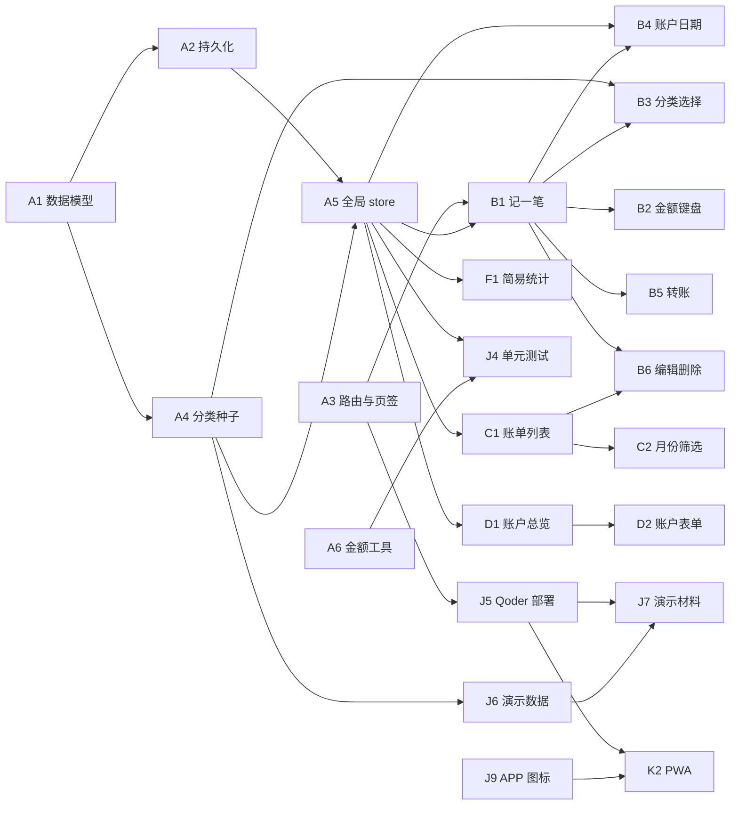

# 账单喵 · 任务拆解（TASK.md）

> 关联 Issue：[#6 需要拆分现有的设计以及对应的任务](https://github.com/rhine9473/billmeow/issues/6)
> 需求来源：[DESIGN.md](./DESIGN.md) · 开发约定：[AGENTS.md](./AGENTS.md)
> 优先级：**P0** 比赛保底必做 · **P1** 有余力再做（超时按第 3 节砍单）· **P2** 赛后再做

## 1. 里程碑

| 日期 | 目标 | 关门条件 |
| ---- | ---- | ---- |
| 11-25（周三） | 任务定稿 + 认领，PR #7 合并 | TASK.md 合并到 main；PR #7 评审通过并合并（PR #7 已合并） |
| 11-26（周四） | 数据层打通 | 可新增一笔支出，刷新页面后数据不丢失；5 个路由页签可正常跳转 |
| 11-27（周五） | 记账闭环 | 可记录支出 / 收入，账单列表与月度汇总正确；账户页可用 |
| 11-28（周六） | 数据呈现 | 简易统计图完成；移动端 bug 清零；P1 任务按剩余时间取舍 |
| 11-29（周日） | 冻结 + 交付 | **12:00 功能冻结**；测试与文档齐全；Qoder Sites 线上地址可访问 |
| 11-30（周一） | 提交 | 上午完成演示材料与最终验收，18:00 截止 |

## 2. 任务表

> 自行认领：直接在条目末尾把 `待认领` 改为自己的 GitHub ID，或在 Issue #6 下回复编号。

### A. 数据与基础设施（P0）

- [x] **A1 数据模型定义** · 依赖：无 · @chairowell
  - 产出：`src/types/bill.ts`
  - 内容：`Account`（资产 / 负债、币种、卡号后四位、初始余额、归档）、`Category`（一级 + 二级、内置 / 自定义、支出 / 收入域）、`Transaction`（支出 / 收入、金额、分类、账户、日期、备注）、`Transfer`（转出 / 转入账户）
  - 验收：四种类型可被 store 引用；金额统一以**整数分**存储，避免浮点误差；`pnpm build` 通过

- [x] **A2 持久化层** · 依赖：A1 · @chairowell
  - 产出：`src/lib/db.ts`（搭配已有 `lib/storage.ts`）
  - 方案：使用 **IndexedDB** 异步存储账单、账户、分类等结构化业务数据（支持大容量、索引与事务，避免同步读写阻塞 UI）；`localStorage` 仅保留用于设置项等轻量 JSON 数据（后续若做原生 App 可扩展 SQLite）
  - 验收：写入后刷新页面，数据不丢失；处理好数据库版本升级与异步异常降级（`storage.ts` 已有 `localStorage` 降级保护）

- [x] **A3 路由与页签骨架** · 依赖：无 · @chairowell
  - 产出：在 PR #7 已有 `src/router/index.ts`（含 `/settings`）基础上补齐其余 4 个路由、改 `/` 重定向，并在 `src/App.vue` 加底部页签
  - 路由：`/records`（账单）、`/record`（记一笔）、`/accounts`、`/stats`、`/settings`
  - 验收：五个页面可互相跳转，且全部按 `views/{name}/index.vue` 懒加载

- [ ] **A4 预设分类种子** · 依赖：A1 · @chairowell
  - 产出：`src/data/categories.ts`
  - 内容：完整预置 DESIGN.md 4.1 支出 10 大类、4.2 收入 8 大类及全部二级分类
  - 验收：首次启动自动写入；内置分类不可删除，仅支持隐藏或改名

- [ ] **A5 全局 store** · 依赖：A1 A2 A4 · @chairowell
  - 产出：`src/stores/accounts.ts`、`categories.ts`、`transactions.ts`
  - 关键 getter：当月支出、当月收入、账户余额、总资产、总负债、净资产（转账不计入收支）
  - 验收：转账后净资产不变；负债账户还款后待还为 0，且当月支出不增加

- [ ] **A6 金额工具** · 依赖：无 · @rhine9473
  - 产出：`src/lib/money.ts`
  - 内容：元 / 分互转、`¥1,234.56` 格式化、输入校验
  - 验收：`0.1 + 0.2` 类场景无精度问题；有单元测试覆盖

### B. 记账闭环（P0 / P1）

> 必做：B1、B3（一级与二级同面板）、B4；P1：B2、B5、B6。

- [ ] **B1 记一笔页面骨架** · 依赖：A3 A5 · @chairowell
  - 产出：`src/views/record/index.vue`
  - 内容：支出 / 收入 / 转账三态切换，表单随类型动态变化
  - 验收：三种类型均可提交并写入 store，返回账单列表后立即可见

- [ ] **B2 金额键盘** · 依赖：B1 · @chairowell
  - 产出：`src/views/record/AmountPad.vue`
  - 验收：移动端单手可操作；支持小数点、退格、清零；不调起系统输入法

- [ ] **B3 分类选择器** · 依赖：A4 B1 · @chairowell
  - 产出：`src/views/record/CategoryPicker.vue`
  - 验收：一级 → 二级联动；切换支出 / 收入时仅显示对应域的分类

- [ ] **B4 账户与日期** · 依赖：A5 B1 · @agave114
  - 产出：表单内的账户选择（资产在前、负债在后并标注）、日期选择、备注
  - 验收：默认账户与默认日期可配置；备注非必填

- [ ] **B5 转账表单** · 依赖：B1 · @agave114
  - 产出：转出账户 → 转入账户选择表单，按 DESIGN.md 4.3 的三种流向给出友好文案（资产互转 / 还款 / 借款入账）
  - 验收：转账不计入当月收支；还款时资产与负债余额同步减少，净资产不变

- [ ] **B6 账单编辑与删除** · 依赖：B1 C1 · @chairowell
  - 验收：可从账单列表进入编辑，修改后汇总同步更新；删除操作需二次确认

### C. 账单列表（P0 / P2）

> 必做：C1；C2 看剩余时间；C3 放 P2。

- [ ] **C1 首页账单列表** · 依赖：A5 · @agave114
  - 产出：`src/views/records/index.vue`
  - 内容：顶部当月收支结余卡 + 按日分组列表（日期、分类、账户、金额、备注）
  - 验收：记账后列表即时刷新；空状态提供引导文案；金额以颜色区分收支

- [ ] **C2 月份切换与筛选** · 依赖：C1 · @agave114
  - 验收：可切换至任意历史月份；支持按类型 / 账户筛选；筛选后汇总同步更新

- [ ] **C3 类型角标** · 依赖：C1 · 待认领
  - 验收：列表中转账与收支条目可一眼区分

### D. 账户管理（P0 / P2）

> 必做：D1；D2 仅做新增账户，编辑与归档放 P2。

- [ ] **D1 账户总览页** · 依赖：A5 · @agave114
  - 产出：`src/views/accounts/index.vue`
  - 内容：总资产 / 总负债 / 净资产三张卡片 + 资产组、负债组列表
  - 验收：数值由 store 实时推导，不存储冗余字段；负债显示为“待还”

- [ ] **D2 账户增删改与归档** · 依赖：D1 · @agave114
  - 验收：可设置名称、类型、图标色、币种与初始余额；已有流水的账户禁止删除，仅支持归档

### E. 分类管理（P2）

> 比赛版不做，直接用 A4 预设分类。

- [ ] **E1 分类管理页** · 依赖：A4 A5 · 待认领
  - 产出：`src/views/categories/index.vue`
  - 验收：一级 / 二级分类可新增、修改与隐藏；内置分类不可删除；新增后记一笔页面立即可选

### F. 统计（P1 / 赛后）

> 比赛版只做 F1 简化版（CSS 横向条形展示当月一级分类占比）；F2 与下钻放赛后。

- [ ] **F1 月度趋势** · 依赖：A5 · 待认领
  - 产出：`src/views/stats/index.vue`
  - 内容：近 6 个月收支柱状对比图
  - 方案：原生 SVG / CSS 手绘，不引入图表库

- [ ] **F2 分类占比** · 依赖：F1 · 待认领
  - 验收：按一级分类展示当月支出占比环形图与图例，点击可下钻至二级分类（下钻为 P2）

### G. CSV 导入（P2）

> 比赛版不做，演示统一用 J6 虚构数据。

- [ ] **G1 解析与统一格式** · 依赖：A1 · 待认领
  - 产出：`src/lib/csv.ts`
  - 范围：支持微信、支付宝两种格式，字段映射至 `Transaction`
  - 验收：可从脱敏样例中正确解析日期、金额、方向与对方户名；解析失败时给出可读报错

- [ ] **G2 去重** · 依赖：G1 · 待认领
  - 规则：金额相同 + 时间差在阈值内 + 账户卡号后四位一致 → 判定为重复并标记跳过
  - 验收：同一份 CSV 导入两次时，第二次新增 0 条；有单元测试覆盖

- [ ] **G3 导入预览页** · 依赖：G1 G2 · 待认领
  - 产出：`src/views/import/index.vue`
  - 验收：导入前先预览（分为新增 / 疑似重复 / 错误三类），确认后再写入

### H. 备份与同步（P2）

- [ ] **H1 全量导出 / 导入 JSON** · 依赖：A2 · 待认领
  - 验收：导出文件可重新导入并完整还原
- [ ] **H2 GitHub 中转多机同步** · 依赖：H1 G2 · 待认领
  - 说明：对应 DESIGN.md 1 去中心化方案；比赛版不做，放赛后（H1 的 JSON 备份可演示“换机还原”）

### I. AI / MCP（P1 尾部，可选）

> 11-28 晚核心功能全达标再启动，否则放赛后，不在提交材料里承诺。

- [ ] **I1 MCP Server 原型** · 依赖：A1 · 待认领
  - 产出：`mcp/` 独立 Node 包，暴露 `list_transactions` / `add_transaction` / `month_summary` 三个工具
  - 验收：在 Claude / Qoder 客户端中可对一个 JSON 账本文件完成问答与记账
- [ ] **I2 自然语言记账** · 依赖：I1 · 待认领
  - 验收：输入“午饭 25 块微信”可生成一条待确认账单
- [ ] **I3 API 文档** · 依赖：I1 · 待认领
  - 产出：`docs/ai-api.md`，包含工具定义、参数说明与调用示例

### J. 质量与交付（P0）

> 必做：J1、J3、J5、J6、J7、J9（关键截图 + 3 分钟演示脚本）；J4 仅测 A6 金额换算与 D1 净资产计算。

- [x] **J1 PR #7 评审与合并** · @chairowell
  - 状态：PR #7 已通过本地 `pnpm build` / `pnpm test` 审查并合并到 `main`（本分支已同步合并 `main`）
- [x] **J2 Issue #8 修复** · @chairowell
  - 状态：已在 PR #7 的 `src/styles/reset.scss` 中修复（设置 `-webkit-tap-highlight-color: transparent` 并保留 `:focus-visible` 可访问性）
- [ ] **J3 移动端适配** · 依赖：B C D · 待认领
  - 验收：底部适配 safe-area，避免遮挡；点击热区 ≥ 44px；375px 宽度下无横向滚动
- [ ] **J4 单元测试补齐** · 依赖：A5 A6 G2 · 待认领
  - 验收：金额换算、去重与净资产计算均有单元测试覆盖；`pnpm test` 全部通过
- [ ] **J5 Qoder Sites 部署** · 依赖：A3 · @agave114 @chairowell
  - 验收：11-27 先跑通空壳地址；线上可正常访问，刷新任意路由不出现 404（SPA 回退）；部署命令写入 README
- [ ] **J6 脱敏演示数据** · 依赖：A4 · @agave114
  - 产出：`public/demo-data.json`，含 3 个月、约 120 条虚构流水
  - 验收：支持一键载入 / 清空，截图与演示视频均使用该数据
- [ ] **J7 演示材料** · 依赖：J5 J6 · 待认领
  - 内容：3 分钟演示脚本、关键界面截图、提交文案（突出 Qoder 开发过程与 AI 记账）
- [ ] **J8 文档站内容** · 依赖：I3 · 待认领
  - 产出：在 `docs/` 下补充功能说明、使用指南与 AI API 页面，并更新 `config.ts` 导航
- [ ] **J9 APP 图标设计** · 依赖：无 · @agave114
  - 产出：`public/favicon.svg`（替换默认 Vite 图标，并作为应用与 PWA 图标源图）
  - 验收：提供简洁清晰的 SVG 矢量图标（贴合“账单喵”主题，亮/暗色背景下均易辨识）；若需接入 PWA（PR #10），同步更新各尺寸衍生图标

### K. 国际化与 PWA（P2）

- [ ] **K1 多语言插槽规范（默认中文）** · @chairowell
  - 方案：推荐页面开发时直接接入 `vue-i18n` 的 `t()` 翻译插槽（或先保证文案可统一替换），默认启用中文语言包；提前排查不同语言字符长度差异导致的显示不全或布局异常
  - 验收：界面默认中文且无残留未翻译占位符；切换语言包时布局不截断、不溢出
- [ ] **K2 PWA 可安装与离线** · 依赖：J5 · @chairowell
  - 方案：`vite-plugin-pwa`（**唯一允许新增的构建期依赖**，独立分支验证 `pnpm build` 与线上产物正常后再合）
  - 验收：手机浏览器可“添加到主屏幕”；离线可打开并查看已加载数据；manifest 图标齐全

## 3. 砍单顺序（时间不足时从上往下砍）

1. **I 模块整体** —— AI / MCP 是加分项，人力不足时整块放弃
2. **K2 PWA** —— 不影响核心演示与线上部署
3. **F1 简化统计图** —— 账单列表的月度汇总已能说明收支
4. **C2 月份切换** —— 仅显示当月
5. **B5 转账** —— 仅支持记录支出 / 收入；会削弱负债账户的演示效果，尽量保留
6. **B2 金额键盘** —— 退回系统数字键盘
7. **B6 编辑与删除** —— 仅支持新增，记错时重新记一笔
8. **D2 账户新增表单** —— 改为预置 3 个示例账户

绝不允许砍：A1、A2、A3、A4、A5、A6、B1、B3、B4、C1、D1、J1、J3、J5、J6、J7、J9。
