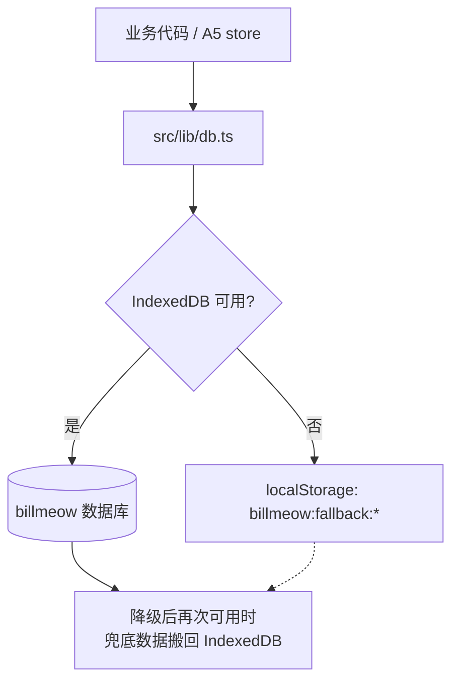
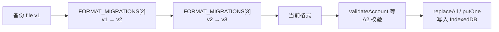

# 持久化层设计说明（DB）

> 适用范围：`src/lib/db.ts` 及其数据迁移、备份导出策略
> 类型层字段语义见 [`src/types/README.md`](./types/README.md)，本文只讲**存储与演进**。
> 关联任务：A2（持久化层，已完成）、H1（全量导出 / 导入 JSON，**尚未实现**，本文只记录方案）

---

## 1. 总体方案

| 数据类型 | 存储介质 | 理由 |
| -------- | -------- | ---- |
| 账单 / 账户 / 分类 / 转账 | **IndexedDB** | 异步、事务、索引，容量大，不阻塞 UI |
| 主题、过渡时长等设置项 | `localStorage`（`lib/storage.ts`） | 轻量 JSON，同步读取足够 |

IndexedDB 不可用时（隐私模式、浏览器禁用、打开失败）**整体降级**到
`localStorage` 同名键 `billmeow:fallback:*`，保证「刷新不丢」这条底线。



### 对象仓库与索引

| 仓库 | `keyPath` | 索引 |
| ---- | --------- | ---- |
| `accounts` | `id` | — |
| `categories` | `id` | `by_domain`(domain)、`by_parent`(parentId) |
| `transactions` | `id` | `by_occurred_at`(occurredAt)、`by_account`(accountId)、`by_category`(categoryId) |
| `transfers` | `id` | `by_occurred_at`(occurredAt)、`by_from_account`、`by_to_account` |

四个仓库名集中定义在 `ALL_STORES`，遍历清空 / 迁移时统一使用，避免各处硬编码漏改。

---

## 2. 写入前与读回后的校验

「存得下、读得回、不写脏」是这一层的唯一职责。跨字段约束类型系统表达不了，
由 `db.ts` 的 `validateXxx` 函数把关，**写入前拒绝，读回时再校验一次**（存储内容可被外部篡改）。

| 校验函数 | 覆盖范围 |
| -------- | -------- |
| `validateAccount` | id / 名称非空、`kind` 合法、币种受支持、初始余额为安全整数、`cardTail` 为 4 位数字 |
| `validateUniqueCardTail` | 账户间卡号后四位不重复（CSV 去重的前提） |
| `validateCategory` | 单条自洽：id / 名称、domain、builtin、parentId、hidden、order |
| `validateCategoryTree` | 整批校验层级：只允许一级 + 二级，父级必须同域且必须是一级 |
| `validateTransaction` | 金额正整数、币种与账户一致、账户 / 分类存在且同域、时间格式、`foreign` 规则 |
| `validateTransfer` | 两侧账户存在且币种匹配、同币种金额必须相等、同币种 `rate` 必须为 `RATE_SCALE` |

读回时校验失败的记录**跳过并记日志**，不中断整页加载——一条脏数据不应让账单打不开。

### 读回校验的两个取舍

1. **`loadTransactions` 一定要带账户表**：记录币种必须与账户币种一致，没有账户表就会误判。
   账户表为空时（例如尚未播种账户），这条规则实际退化为「跳过」，属于已知边界。
2. **跳过而不是抛错**：`loadAll` 返回原始数组，`loadXxx` 逐条过滤。
   数据量小的时候没必要引入「错误列表 UI」，先记日志，等分类管理界面落地再考虑上报给用户。

---

## 3. 数据库版本升级

使用 IndexedDB 原生版本机制：`indexedDB.open(DB_NAME, DB_VERSION)`。

### 3.1 改结构时的步骤

1. `DB_VERSION` +1；
2. 在 `MIGRATIONS` 里**新增**一项 «目标版本 → 升级函数»，只描述 `v(n-1) → v(n)` 的增量；
3. 已有数据用 `openCursor` 遍历后 `cursor.update({ ...value, 新字段 })` 改写，
   或只补索引（`ensureIndexes` 幂等）；
4. **不要 `deleteObjectStore` 后重建**——那会连同用户的账目一起清空。

> 当前 `DB_VERSION = 1`，`MIGRATIONS` 只有 `1: migrateToV1`。

### 3.2 版本号对应的是「目标版本」，不是「上一版库表」

这是最容易理解错的一点。`MIGRATIONS[2]` 的语义是**「升级到 v2 要做的事」**，
而不是「v1 的库表长什么样」。v1 的库表已由 `1: migrateToV1` 建好，不会重跑。

| 用户当前版本 | 实际执行 |
| ----------- | -------- |
| 0（全新安装） | `v1` → `v2` |
| 1（已用上一版） | 只跑 `v2` |
| 2（最新） | 什么都不跑 |

因此新迁移函数只能假设「进来时数据已是 v1 的样子」，只补 v1 没有的东西。
若它假设自己从空库开始、去重建 `accounts`，已装机用户会直接撞仓库重名抛错，
整个升级事务回滚。

### 3.3 跨版本升级（用户很久没升级）

**不需要任何特判。** `runMigrations` 从 `event.oldVersion + 1` 逐版循环到 `DB_VERSION`：

```
用户库 v1，代码 v4  →  依次执行 v2、v3、v4
用户库 v0，代码 v4  →  依次执行 v1、v2、v3、v4
用户库 v4，代码 v4  →  一次都不执行
```

三条路径共用同一段循环。跨版本能成立，靠的是三个前提：

| 前提 | 为什么 | 本项目怎么保证 |
| ---- | ------ | -------------- |
| 每个函数只依赖「上一版」的结构 | 它只会在 `oldVersion+1` 那一步执行，进来时数据一定是 `v(n-1)` 的样子 | `MIGRATIONS` 键 = 目标版本；禁止回头改旧项 |
| 所有结构操作幂等 | 升级事务中止后，浏览器下次打开会**从同一个 `oldVersion` 重跑** | `migrateToV1` 每处都先 `objectStoreNames.contains`；补索引走 `ensureIndexes` |
| 失败整体回滚 | 第 3 步失败不能让前 2 步的改动留在用户库里 | 迁移抛错 → `tx.abort()`，回到 `oldVersion`，下次从头再试 |

第二条的前提是第一条的结果：**因为整体回滚，"跨版本"从来不会只完成一部分**。
用户要么是完整的 v1，要么是完整的 v4，不存在「v2 字段有了、v3 的没有」这种中间态。

还有两点跨版本特有的约束：

- **`oldVersion` 以浏览器的值为准**，不要自己记录、也不要假设「用户上次是 v1」；
- **兜底数据搬迁不能按版本号判断**：用户可能在 v2 时降级写入 `localStorage`，
  直到 v5 才回来。`adoptFallbackStores` 判断的是「该仓库下有没有兜底键」，
  与具体版本无关，因此任意版本跳上来都能接住。

---

## 4. 两条硬性约束

### 4.1 升级事务里不能 `await`

`onupgradeneeded` 的事务在「没有待处理请求」时会**自动提交**，
一 `await`（哪怕只是 `await Promise.resolve()`）后续写入就全部丢失。

因此迁移函数只能做「结构 + 数据修补」，需要异步或跨存储的计算一律登记下来，
等新连接拿到后另开事务执行——这就是 `postMigration` 存在的原因。

```ts
/* 迁移里只登记「事后要做什么」 */
adoptStore('accounts')

/* 新连接 onsuccess 里再真正搬数据 */
resolve(db)
if (outcome.adopt.length > 0) void postMigration(db, outcome.adopt)
```

### 4.2 失败必须回滚，版本降级必须拒绝

| 情况 | 处理 | 理由 |
| ---- | ---- | ---- |
| 迁移函数抛错 | `tx.abort()` + `reject`，抛 `DbError('invalid')` | 回滚到旧版本，用户数据原样保留，下次可重试 |
| 库版本比代码新（`VersionError`） | 直接拒绝打开并提示 | **不回退写兜底存储**，新旧结构混写会真正损坏数据 |
| 打开失败且非迁移原因 | 降级到 `localStorage` 并提示 | 隐私模式 / 浏览器禁用的正常兜底路径 |

---

## 5. 数据来源迁移（localStorage → IndexedDB）

早期版本（A2 降级期）在 IndexedDB 不可用时把数据写入 `billmeow:fallback:*`。
库升级时若发现兜底键里有数据，会自动搬进 IndexedDB：

| 情况 | 处理 |
| ---- | ---- |
| 同一 `id` 两边都有 | 以 IndexedDB 为准（用户后来的操作比兜底数据更新） |
| 搬运成功 | 删除兜底键，避免下次重复搬迁 |
| 搬运失败 | 日志 + 提示，兜底数据原样保留，刷新后重试 |

---

## 6. 慢速迁移的卸载方案：导出 / 导入备份

> **状态：仅作方案记录，尚未实现。** 对应任务 H1「全量导出 / 导入 JSON」。

### 6.1 什么时候才需要它

| 场景 | 推荐路径 |
| ---- | -------- |
| 几十 ~ 几百条记录，结构只加字段 | 原地迁移（`MIGRATIONS`），无感完成 |
| 数万条以上，或要重算全部金额 | 导出 → 导入 |
| 跨多个大版本、语义已变 | 导出 → 导入 |

导出方案的本质是：把「增量迁移」换成「格式转换」，**增量迁移拿不到的上下文，格式转换拿得到**。

### 6.2 它不能取代自动迁移

导出 / 导入是**用户主动操作**，迁移是**自动发生**的。
「用户很久没升级、直接打开新版」这条路径永远会走 IndexedDB 升级流程，
慢迁移的风险依然存在，只是触发概率变低。

两者分工：

- `MIGRATIONS` 负责**默认路径**，且只放轻量操作（建表、补索引、补默认值）；
  重计算（如重算全部余额）不要塞进升级事务，下沉到 `postMigration` 分段执行；
- H1 导出 / 导入是**大型迁移的卸载入口**，同时是取证产物与「换机还原」的依据。

### 6.3 成立的前提

**前提一：备份文件必须自带版本号**

```json
{
  "format": "billmeow-backup",
  "formatVersion": 2,
  "exportedAt": "2026-11-27T10:00:00",
  "appVersion": "0.0.4",
  "data": { "accounts": [], "categories": [], "transactions": [], "transfers": [] }
}
```

没有 `formatVersion`，新版本导入方就不知道该用哪套转换逻辑，只能盲猜字段结构。

**前提二：备份格式版本与 `DB_VERSION` 解耦**

| 版本号 | 描述 | 约束范围 |
| ------ | ---- | -------- |
| `DB_VERSION` | IndexedDB 内部的**物理结构**（对象仓库、索引） | 只影响本机存储 |
| `formatVersion` | 备份文件的**对外约定** | 跨设备、跨版本、跨外部工具 |

物理结构改动时格式可能完全没变（例如只是加了个索引），此时 `formatVersion` 不该动；
格式加字段时也不一定改库结构（导入时能重算出来的字段就不必存）。
共用同一个号，等于「加一个索引就让所有旧备份作废」。

**前提三：导入侧需要一条逐版转换链**

复用 `MIGRATIONS` 的心智模型，只是把「数据库连接」换成「内存对象」：



规则与数据库迁移一致：按版本链逐级递推、每步只写增量、跳版时照样按链走。

### 6.4 现在就能定下来的骨架

`db.ts` 已经具备全部必要条件（读数、校验、批量写入），导出 / 导入落地时**不需要改动它**。
真正要现在定的是备份格式的三条约定：

1. **外层包装**：`format` / `formatVersion` / `exportedAt` / `data`，缺一不可；
2. **四个数组直接复用 `Account` / `Category` / `Transaction` / `Transfer` 原型**，
   **不要**转换字段名——导入时过一遍 `validateAccount` 等就能保证一致性；
   转换字段名等于再维护一套映射，两边都要改；
3. **金额保持整数最小单位原样导出**，不做「转成元」的转换，备份必须无损还原。

### 6.5 后续实现清单

- [ ] `src/lib/backup.ts`：`exportBackup(): BackupFile`、`importBackup(file: unknown)`、
      `FORMAT_VERSION`、`FORMAT_MIGRATIONS`
- [ ] 导入前跑完整校验（账户 → 分类 → 记录 / 转账，顺序不能反，后者依赖前者）
- [ ] 导入前提供预览（新增 / 冲突 / 错误三类），确认后再写入
- [ ] 外部迁移工具：读取同一份 `formatVersion` 约定即可，不必依赖本仓库代码

---

## 7. 已知边界

| 边界 | 现状 | 后续 |
| ---- | ---- | ---- |
| 升级要遍历海量记录、耗时过长 | 暂未优化，靠 `blocked` 报错兜底 | 大计算下沉 `postMigration`，或引导用户走导出导入 |
| 多标签页同时升级 | 其他标签页收到 `versionchange` 主动 `db.close()`，升级方 `onblocked` 报错 | 可加「请关闭其他标签页」的友好提示 |
| 读回脏数据只记日志 | 用户看不到哪些记录被跳过 | 分类管理 / 数据体检页落地后再上报 |
| 无级联删除保护以外的引用完整性 | 删除账户前检查流水，删除分类未检查记录引用 | 补 `deleteCategory` 的引用检查 |
